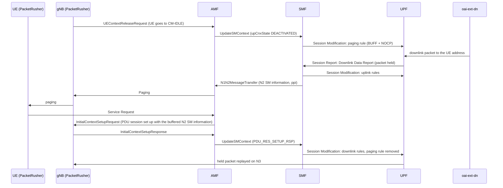

<!-- SPDX-License-Identifier: CC-BY-4.0 -->

<table style="border-collapse: collapse; border: none;">
  <tr style="border-collapse: collapse; border: none;">
    <td style="border-collapse: collapse; border: none;">
      <a href="http://www.openairinterface.org/">
         
         </img>
      </a>
    </td>
    <td style="border-collapse: collapse; border: none; vertical-align: center;">
      <b><font size = "5">OpenAirInterface 5G Core Network Paging Test with PacketRusher</font></b>
    </td>
  </tr>
</table>

# Paging With PacketRusher

This tutorial deploys the basic OAI 5G Core with paging enabled and tests the network-triggered service request with PacketRusher: the UE goes to CM-IDLE, the external data network sends it a downlink packet, the core pages the UE, the UE answers with a Service Request, and the packet the UPF held while the UE was idle is delivered once the user plane is back.



## At A Glance

| Item | Value |
| ---- | ----- |
| Goal | Page an idle UE with downlink traffic and check the network-triggered service request |
| Working directory | `oai-cn5g-fed/docker-compose` |
| Core compose file | `docker-compose-basic-nrf.yaml` |
| RAN compose file | `docker-compose-packetrusher.yaml` (one PacketRusher gNB and UE) |
| Reference configuration | `conf/basic_nrf_config.yaml`, with paging enabled in [section 2](#2-enable-paging) |
| PacketRusher configuration | `ran-conf/packetrusher.yaml` |
| Subscription database | `database/oai_db2.sql`, IMSI `208950000000031` |
| Robot test equivalent | `Paging Of An Idle UE` in [test/packetrusher_tests.robot](../test/packetrusher_tests.robot) |
| Result folder used below | `/tmp/oai/paging-packetrusher` |

**Reading time**: ~15 minutes

**Replication time**: ~20-30 minutes, depending on image availability.

**TABLE OF CONTENTS**

[[_TOC_]]

Use the document outline or your Markdown viewer to navigate between sections.

## 1. Pre-Requisites

Complete the [deployment pre-requisites](./DEPLOY_PRE_REQUISITES.md) and the image retrieval of the [basic deployment](./DEPLOY_SA5G_BASIC_DEPLOYMENT.md#1-pre-requisites) first. Paging needs AMF, SMF and UPF images that include the paging support.

> **Note**: until the paging support is merged in `develop`, build the AMF, SMF and UPF images from the `amf_paging_procedure`, `smf_paging_procedure` and `upf_paging_procedure` branches (with `common-src` on `paging_procedure_support`) as described in [Build images](./BUILD_IMAGES.md).

Pull the PacketRusher image used by the robot tests:

```console
docker pull oaisoftwarealliance/packet-rusher:fix-5gstmsi-amf
```

PacketRusher runs here without `--tunnel`, so the host needs no `gtp5g` kernel module: the user plane is checked from the core side, in the UPF logs. [Section 6](#6-optional-ping-through-the-ue-tunnel) shows the `--tunnel` variant for hosts that have `gtp5g`.

All commands below run from the `docker-compose` folder:

``` shell
docker-compose-host $: rm -rf /tmp/oai/paging-packetrusher
docker-compose-host $: mkdir -p /tmp/oai/paging-packetrusher
docker-compose-host $: chmod 777 /tmp/oai/paging-packetrusher
```

Enable IPv4 forwarding on the host:

```console
sudo sysctl net.ipv4.conf.all.forwarding=1
sudo iptables -P FORWARD ACCEPT
```

## 2. Enable Paging

Paging is off by default. Three settings in [conf/basic_nrf_config.yaml](../docker-compose/conf/basic_nrf_config.yaml) turn it on:

| NF | Setting | Value | Effect |
| -- | ------- | ----- | ------ |
| SMF | `smf.paging.enable` | `yes` | On AN release, the SMF installs a paging rule (a downlink PDR with a BUFF + NOCP FAR) on the UPF. A Downlink Data Report for that rule starts the paging. |
| SMF | `smf.paging.paging_policy_indicator` | `1` | Sent to the AMF in the N1N2 message transfer (`ppi`); the AMF maps it to the NGAP Paging Priority. Range 0 to 7. |
| UPF | `upf.datapath_configuration.enable_dl_buffering` | `yes` | The UPF holds the downlink packets that hit the paging rule and replays them once the SMF restores the downlink rules. With `no`, the SMF is still notified but the packets are dropped. |

The UPF entry in `smf.upfs` must keep `enable_dl_pdr_in_pfcp_session_establishment` at its default, `no`: with both set, the SMF refuses to start. The AMF needs no paging setting.

Add the three settings:

``` shell
docker-compose-host $: grep -q "^  paging:" conf/basic_nrf_config.yaml || sed -i 's/^  ue_mtu: 1500$/  ue_mtu: 1500\n  paging:\n    enable: yes\n    paging_policy_indicator: 1/' conf/basic_nrf_config.yaml
docker-compose-host $: grep -q "^  datapath_configuration:" conf/basic_nrf_config.yaml || sed -i 's/^  remote_n6_gw: localhost .*$/&\n  datapath_configuration:\n    enable_dl_buffering: yes/' conf/basic_nrf_config.yaml
docker-compose-host $: grep -A2 "^  paging:" conf/basic_nrf_config.yaml
docker-compose-host $: grep -A1 "^  datapath_configuration:" conf/basic_nrf_config.yaml
```

Expected result:

```yaml
smf:
  ue_mtu: 1500
  paging:
    enable: yes
    paging_policy_indicator: 1
...
upf:
  ...
  remote_n6_gw: localhost      # Dummy host since simple-switch does not use N6 GW
  datapath_configuration:
    enable_dl_buffering: yes
```

The UPF keeps the simple switch datapath of the basic deployment. For the eBPF datapath, also set `upf.support_features.enable_bar: yes`; see the UPF [paging documentation](https://github.com/openairinterface/oai-cn5g-upf/blob/develop/docs/PAGING.md).

## 3. Deploy The Basic Core

Start the core and wait for the containers used by this tutorial. After AMF is running, update `ran-conf/packetrusher.yaml` with the AMF container IP that Docker assigned on the `demo-oai-public-net` network.

``` shell
docker-compose-host $: docker-compose -f docker-compose-basic-nrf.yaml up -d
docker-compose-host $: timeout 180 bash -c 'until [ "$(docker inspect -f "{{.State.Health.Status}}" mysql 2>/dev/null)" = "healthy" ]; do sleep 2; done'
docker-compose-host $: timeout 120 bash -c 'until [ "$(docker inspect -f "{{.State.Health.Status}}" oai-nrf 2>/dev/null)" = "healthy" ]; do sleep 2; done'
docker-compose-host $: timeout 120 bash -c 'until [ "$(docker inspect -f "{{.State.Health.Status}}" oai-amf 2>/dev/null)" = "healthy" ]; do sleep 2; done'
docker-compose-host $: timeout 120 bash -c 'until [ "$(docker inspect -f "{{.State.Health.Status}}" oai-smf 2>/dev/null)" = "healthy" ]; do sleep 2; done'
docker-compose-host $: timeout 120 bash -c 'until [ "$(docker inspect -f "{{.State.Health.Status}}" oai-upf 2>/dev/null)" = "healthy" ]; do sleep 2; done'
docker-compose-host $: timeout 120 bash -c 'until [ "$(docker inspect -f "{{.State.Health.Status}}" oai-ext-dn 2>/dev/null)" = "healthy" ]; do sleep 2; done'
docker-compose-host $: sed -i "/^amfif:/,/port:/ s/ip: \".*\"/ip: \"$(docker inspect -f '{{range .NetworkSettings.Networks}}{{.IPAddress}}{{end}}' oai-amf)\"/" ran-conf/packetrusher.yaml
docker-compose-host $: docker-compose -f docker-compose-basic-nrf.yaml ps -a
```

Expected status: all core containers should be `running` or `healthy`.

Check that paging is enabled in the SMF:

``` shell
docker-compose-host $: docker logs oai-smf 2>&1 | grep -A2 "paging_config"
```

```console
[config ] [info]   - paging_config
[config ] [info]     + enable.....................................: Yes
[config ] [info]     + paging_policy_indicator....................: 1
```

Start a packet capture. The Docker network, and with it the `demo-oai` host bridge, exists by this point:

``` shell
docker-compose-host $: nohup sudo tshark -i demo-oai -f "sctp or tcp port 80 or tcp port 8080 or udp port 2152 or udp port 8805" -w /tmp/oai/paging-packetrusher/paging.pcap > /tmp/oai/paging-packetrusher/paging-capture.log 2>&1 &
```

## 4. Start PacketRusher And Let The UE Go Idle

This flow uses:

- [docker-compose-packetrusher.yaml](../docker-compose/docker-compose-packetrusher.yaml) to start `packetrusher`, one gNB and one UE, at `192.168.70.156` (N2 and N3).
- [ran-conf/packetrusher.yaml](../docker-compose/ran-conf/packetrusher.yaml), with IMSI `208950000000031`, SST `222`, SD `00007B` and DNN `default`, whose AMF address was updated in [section 3](#3-deploy-the-basic-core).

The compose file runs the paging scenario of the robot test:

| Option | Value | Meaning |
| ------ | ----- | ------- |
| `multi-ue -n 1 --dedicatedGnb` | | one UE on its own gNB |
| `--timeBeforeIdle` | `15000` | the UE goes to CM-IDLE 15 s after its PDU session is up: the gNB sends a UE Context Release Request |
| `--timeBeforeReconnecting` | `300000` | the UE then stays idle for 300 s, so only paging can bring it back earlier |

Start PacketRusher and wait for the PDU session:

``` shell
docker-compose-host $: docker-compose -f docker-compose-packetrusher.yaml up -d
docker-compose-host $: timeout 60 bash -c 'until docker logs packetrusher 2>&1 | grep -q "PDU address received"; do sleep 2; done'
docker-compose-host $: docker logs packetrusher 2>&1 | grep "PDU address received"
```

```console
level=info msg="[UE][NAS] PDU address received: 12.1.1.2"
```

The UE address is in the `default` DNN subnet, `12.1.1.0/26`. Wait for the UE to go idle, and check that the SMF armed the paging rule when the AMF reported the AN release:

``` shell
docker-compose-host $: timeout 60 bash -c 'until docker logs packetrusher 2>&1 | grep -q "Switching to 5GMM-IDLE"; do sleep 2; done'
docker-compose-host $: timeout 30 bash -c 'until docker logs oai-smf 2>&1 | grep -q "Paging armed for SEID"; do sleep 2; done'
docker-compose-host $: docker logs oai-smf 2>&1 | grep "Paging armed for SEID"
```

```console
[smf_app] [info] Paging armed for SEID 0x1 (PDR 3 / FAR 3)
```

## 5. Page The UE

Send downlink traffic from the external data network to the idle UE. The ping is expected to get no reply: without `--tunnel`, PacketRusher's UE has no interface to answer from. What matters is that its first packet reaches the UPF while the UE is idle.

``` shell
docker-compose-host $: docker exec oai-ext-dn ping -c 4 -W 3 $(docker logs packetrusher 2>&1 | grep -o "PDU address received: [0-9.]*" | tail -1 | cut -d" " -f4) || true
```

PacketRusher receives the page and answers it with a Service Request:

``` shell
docker-compose-host $: timeout 30 bash -c 'until docker logs packetrusher 2>&1 | grep -q "Receive Paging"; do sleep 2; done'
docker-compose-host $: timeout 30 bash -c 'until docker logs packetrusher 2>&1 | grep -q "Receive Service Accept"; do sleep 2; done'
docker-compose-host $: docker logs packetrusher 2>&1 | grep -E "Receive Paging|Initiating Service Request|Receive Service Accept"
```

```console
level=info msg="[GNB][NGAP] Receive Paging"
level=info msg="[UE] Initiating Service Request"
level=info msg="[UE][NAS] Receive Service Accept"
```

Follow the procedure through the core. The UPF reports the downlink data, holds the packet and replays it on N3 once the downlink rules are back:

``` shell
docker-compose-host $: docker logs oai-upf 2>&1 | grep -E "Sending SESSION REPORT REQUEST \(DLDR\)|DL buffer seid .*: replay sent"
```

```console
[upf_n4 ] [info] Sending SESSION REPORT REQUEST (DLDR) seid 0x1 pdr 3
[pfcp_switch] [info] DL buffer seid 0x1: replay sent 1, dropped 0, rebuffered 0
```

The SMF starts the network-triggered service request, asks the AMF to page the UE, and removes the paging rule when the user plane is restored. That last line is logged only once the UPF has acknowledged the downlink rules, so wait for it:

``` shell
docker-compose-host $: timeout 30 bash -c 'until docker logs oai-smf 2>&1 | grep -q "Paging: the paging rule of SEID .* is removed"; do sleep 2; done'
docker-compose-host $: docker logs oai-smf 2>&1 | grep -E "Paging: starting a network-triggered service request|ATTEMPTING_TO_REACH_UE|Paging: the paging rule of SEID .* is removed"
```

```console
[smf_app] [info] Paging: starting a network-triggered service request for SEID 0x1
[smf_sbi] [debug] Response data {"cause":"ATTEMPTING_TO_REACH_UE"}
[smf_sbi] [debug] Response from AMF, HTTP Code: 202, cause ATTEMPTING_TO_REACH_UE
[smf_app] [debug] Got response from AMF (response code 202) with cause ATTEMPTING_TO_REACH_UE
[smf_app] [info] Paging: the paging rule of SEID 0x1 is removed from the UPF (PDR 3 / FAR 3 released)
```

The AMF opens a paging transaction and keeps the N2 SM information that the SMF sent with the N1N2 message transfer. When the UE answers with its Service Request, the AMF sets the PDU session up with that information in the Initial Context Setup Request, so the session is set up once. The GUTI and the timer ID differ from run to run:

``` shell
docker-compose-host $: docker logs oai-amf 2>&1 | grep -E "Paging transaction opened|is set up with the N2 SM information buffered for the page|answered paging transaction"
```

```console
[amf_app] [info] Paging transaction opened for GUTI 208950100413077178613; the response window (10 s) is armed (timer 16)
[amf_n1] [info] PDU Session ID 1 is set up with the N2 SM information buffered for the page
[amf_n1] [info] SUPI imsi-208950000000031 answered paging transaction 1 (GUTI 208950100413077178613)
```

The UE stays registered and PacketRusher keeps running; `State` is `Up`. The AMF, SMF and UPF must still be running too: the second command fails if one of them stopped during the procedure.

``` shell
docker-compose-host $: docker-compose -f docker-compose-packetrusher.yaml ps -a
docker-compose-host $: for nf in oai-amf oai-smf oai-upf; do [ "$(docker inspect -f '{{.State.Running}}' $nf)" = true ] || { echo "$nf is not running"; exit 1; }; done
```

## 6. (Optional) Ping Through The UE Tunnel

On a host with the `gtp5g` kernel module loaded, PacketRusher can create the UE's GTP-U tunnel, and the user plane can be checked from the UE as well. Add `--tunnel` to the PacketRusher command in [docker-compose-packetrusher.yaml](../docker-compose/docker-compose-packetrusher.yaml), restart it, and once the page has completed ping the external data network from the UE's VRF, as `Ping From Ue` does in the robot test:

```console
docker exec packetrusher ip vrf exec vrf0000000031 ping -c 4 $(docker inspect -f '{{range .NetworkSettings.Networks}}{{.IPAddress}}{{end}}' oai-ext-dn)
```

This step is not part of the automated check.

## 7. Collect Logs

Stop any running `tshark` capture first:

``` shell
docker-compose-host $: sudo pkill tshark || true
docker-compose-host $: sleep 5
docker-compose-host $: sudo chmod 666 /tmp/oai/paging-packetrusher/paging*
```

Collect core logs:

``` shell
docker-compose-host $: docker logs oai-amf > /tmp/oai/paging-packetrusher/amf.log 2>&1
docker-compose-host $: docker logs oai-smf > /tmp/oai/paging-packetrusher/smf.log 2>&1
docker-compose-host $: docker logs oai-nrf > /tmp/oai/paging-packetrusher/nrf.log 2>&1
docker-compose-host $: docker logs oai-upf > /tmp/oai/paging-packetrusher/upf.log 2>&1
docker-compose-host $: docker logs oai-udr > /tmp/oai/paging-packetrusher/udr.log 2>&1
docker-compose-host $: docker logs oai-udm > /tmp/oai/paging-packetrusher/udm.log 2>&1
docker-compose-host $: docker logs oai-ausf > /tmp/oai/paging-packetrusher/ausf.log 2>&1
docker-compose-host $: docker logs oai-ext-dn > /tmp/oai/paging-packetrusher/ext-dn.log 2>&1
```

Collect the PacketRusher log:

``` shell
docker-compose-host $: docker logs packetrusher > /tmp/oai/paging-packetrusher/packetrusher.log 2>&1
```

In the capture, the procedure appears in this order on `demo-oai`: NGAP `UEContextReleaseRequest`, the SMF `/modify` with `upCnxState: DEACTIVATED`, PFCP Session Modification, PFCP Session Report Request and Response, PFCP Session Modification, the N1N2 message transfer (`202`), NGAP `Paging`, NGAP `InitialUEMessage` with the Service Request, NGAP `InitialContextSetupRequest` carrying the PDU session and its `InitialContextSetupResponse`, the SMF `/modify` with `PDU_RES_SETUP_RSP`, and the last PFCP Session Modification. There is no separate `PDUSessionResourceSetupRequest` after the page.

## 8. Cleanup

Stop PacketRusher:

``` shell
docker-compose-host $: docker-compose -f docker-compose-packetrusher.yaml down -t 2
```

Stop the core:

``` shell
docker-compose-host $: docker-compose -f docker-compose-basic-nrf.yaml down -t 2
```

Return the configuration files to the default tutorial state:

``` shell
docker-compose-host $: sed -i '/^  paging:$/,/^    paging_policy_indicator: 1$/d' conf/basic_nrf_config.yaml
docker-compose-host $: sed -i '/^  datapath_configuration:$/,/^    enable_dl_buffering: yes$/d' conf/basic_nrf_config.yaml
docker-compose-host $: sed -i '/^amfif:/,/port:/ s/ip: ".*"/ip: "192.168.70.132"/' ran-conf/packetrusher.yaml
```

## 9. Troubleshooting

| Symptom | First check |
| ------- | ----------- |
| The SMF does not start | `docker logs oai-smf`: `paging.enable is not supported together with a UPF configured with enable_dl_pdr_in_pfcp_session_establishment` means that option is set for the UPF in `smf.upfs`; remove it |
| PacketRusher does not connect to the AMF | Confirm `ran-conf/packetrusher.yaml` contains the current `oai-amf` container IP from `docker inspect` |
| PacketRusher logs `Switching to 5GMM-IDLE` but the SMF never logs `Paging armed` | `docker logs oai-amf 2>&1 \| grep UEContextRelease`. `Check UEContextReleaseRequest message error` means the AMF dropped the release request: PacketRusher sends it with procedure criticality `reject`, which needs an AMF with the paging support. Also confirm `smf.paging.enable: yes` |
| `oai-ext-dn` never becomes healthy, and its log shows `Nexthop has invalid gateway` | `oai-ext-dn` resolved `oai-upf` to an address outside the Docker network: the host's DNS search domain answers any name, and the lookup ran before Docker knew `oai-upf`. Restart it once the UPF is up: `docker-compose -f docker-compose-basic-nrf.yaml restart oai-ext-dn` |
| No `Sending SESSION REPORT REQUEST (DLDR)` in the UPF log | Check that the downlink packet reaches the UPF: `docker exec oai-ext-dn ip route` must route `12.1.1.0/24` to `oai-upf` |
| The UPF sends the DLDR but PacketRusher never logs `Receive Paging` | `docker logs oai-smf 2>&1 \| grep -E "Paging:\|Response from AMF"` for the N1N2 message transfer answer, then `docker logs oai-amf 2>&1 \| grep -i paging` |
| PacketRusher exits after `Receive Service Accept` with `Decode NAS error empty message` | The AMF sent the buffered N2 SM information with an empty NAS-PDU; use an AMF with the paging support |
| PacketRusher exits after the page with `SEQUENCE OF Size is lower than lowerbound` | The AMF set the PDU session up twice, in the Initial Context Setup Request and again in a PDU Session Resource Setup Request; `docker logs oai-amf 2>&1 \| grep "Delivering .* buffered"` shows the second one. Use an AMF with the paging support, which logs `is set up with the N2 SM information buffered for the page` instead |
| `oai-smf is not running` (or `oai-amf`, `oai-upf`) after the page | The NF stopped during the procedure: `docker logs <container> 2>&1 \| tail -50` shows where; collect the logs as in [section 7](#7-collect-logs) and report it |
| `replay sent 0` or no replay line in the UPF log | Confirm `upf.datapath_configuration.enable_dl_buffering: yes`; without it the UPF drops the held packet |

## 10. Report An Issue

When opening an issue, include:

1. The commands used to start the core and PacketRusher.
2. The edited parts of `conf/basic_nrf_config.yaml` and `ran-conf/packetrusher.yaml`.
3. Logs from the affected containers, PacketRusher included.
4. Packet captures from `demo-oai` when available.

For contribution workflow details, see [CONTRIBUTING.md](../CONTRIBUTING.md).
